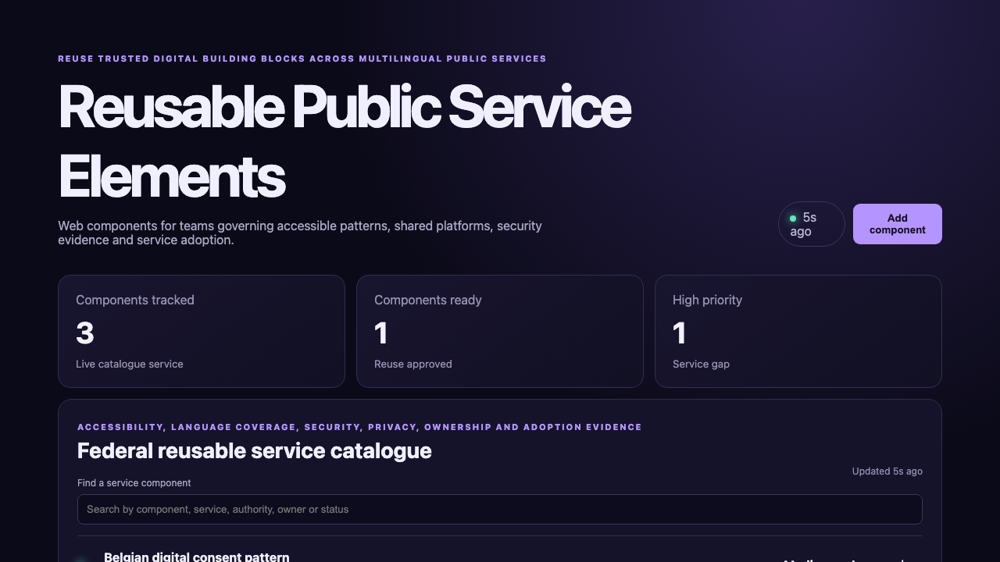

# Reusable Public Service Elements

## One-sentence benefit

Help public administrations reuse accessible, secure and multilingual digital-service building blocks.

## Live demo

[Watch the workflow](docs/demo.webm).

## Screenshots

## Main features

- Search and sort components by service, authority, owner or status.
- Create real catalogue records through the Java API.
- Advance components through draft, review and approved states.
- Show loading, empty, error and success feedback.
- Reuse encapsulated metric and workflow components responsively.

## Technology used

Lit, TypeScript, reactive controllers, custom elements, Vite, Spring Boot and Java 21.

## Installation instructions

Install Node.js 22 and Java 21. Run `npm install`, start `cd backend && mvn spring-boot:run`, then run `npm run dev`.

## Commercial licensing/contact

Commercial licensing and integration support are available through the repository contact options.

## Business problem and users

Federal services, municipalities and delivery partners need shared components that reduce duplicate work without centralising every service.

## Key workflows

Find a component, create a catalogue record, assign ownership, advance review and confirm the API result.

## Lit/Web Components framework highlights

Lit reactive properties, keyed repeat directives, shadow DOM metric cards and a lifecycle controller create reusable elements.

## Java backend highlights

Spring Boot exposes validated list, search, create and update APIs, clear errors, health status and service tests.

## Architecture and state flow

Custom elements call `/api/items`; Java validates requests and returns records that trigger Lit rendering.

## Accessibility and responsive behaviour

Labelled controls, semantic regions, visible focus styles and responsive shadow-DOM layouts support keyboard and small screens.

## Verification commands

Run `npm test`, `npm run build`, `cd backend && mvn test` and `cd backend && mvn package`.

## Structure

`src` contains the frontend, `backend` contains Java and `docs` contains inspected media.

## Tradeoffs

In-memory records simplify local use; production needs identity, persistence and government-platform integrations.

## Roadmap

Add usage analytics, version policy, accessibility evidence, multilingual previews and cross-service dependency maps.
